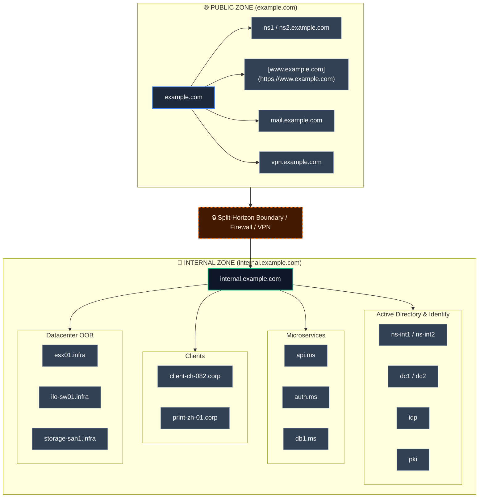

# DNS (Domain Name System)

**Default Ports:** `53` (UDP/TCP) 
**Description:** Responsible for name resolution hostname to ip-address

---

## 01 - Enumeration

### Quick Check / Banner Grabbing

### Deep Enumeration
### Zones

![[Dig#Zone Transfer (AXFR)]]

![[Dig#Dig Standard Zones]]

#### Bind Version-Check
![[Dig#^314980]]

### OSINT enumeration
![[Subfinder#^eb9d30]]

### Bruteforce subsites
> [!INFO] Note
Better user Gobuster and check all Zone-types, e.g A, TXT, MX, etc. 

![[Dnsenum#^25560d]]![[subrute#Using subrute DNS-ENUM]]